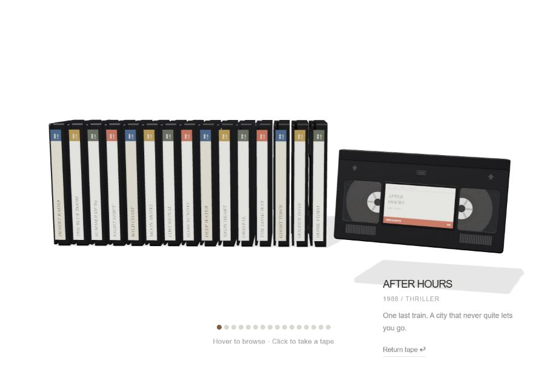

# VHS Library

A minimal, interactive Three.js VHS cassette selector on a white background. Sixteen tapes sit in one row across the middle of the screen. Hover to pull a tape forward; click to extract it and reveal its face and a short description. The selected cassette tilts with your pointer.



## Run locally

Requires Node.js. No dependency installation or build step is needed.

```sh
npm run dev
```

Open **http://127.0.0.1:5173**. The demo loads Three.js 0.169.0 from jsDelivr, so an internet connection is required.

```sh
npm run check
```

## Reuse the component

Copy `dist/vhs-selector.js` into your project. Install `three` in your project, or use the import map in `dist/index.html`.

```js
import { mountVhsSelector, library } from './vhs-selector.js';

const selector = mountVhsSelector(element, {
  onSelect(index) {
    // index is null when the tape is returned.
    const tape = index === null ? null : library[index];
  }
});

selector.select(0);
// Clean up when the component unmounts:
selector.dispose();
```

Give the container a width and height. Edit `library` to customize titles, colors, and descriptions; all film data is fictional demo content.

The cassette geometry uses proportions of 187 × 103 × 25, with rounded black shells, reel windows, modeled magnetic spools, molded details, and procedural paper labels. No external image assets are needed by the demo.

`dist/index.html` provides the description panel and keyboard accessible tape buttons. Press Escape or select **Return tape** to put a cassette back. Reduced motion preferences are respected.

## Hosted demo

[Open the demo](https://vhs-shelf-anas.fair-otter-1398.chatgpt.site). The hosted demo currently requires the owner's ChatGPT sign-in.
